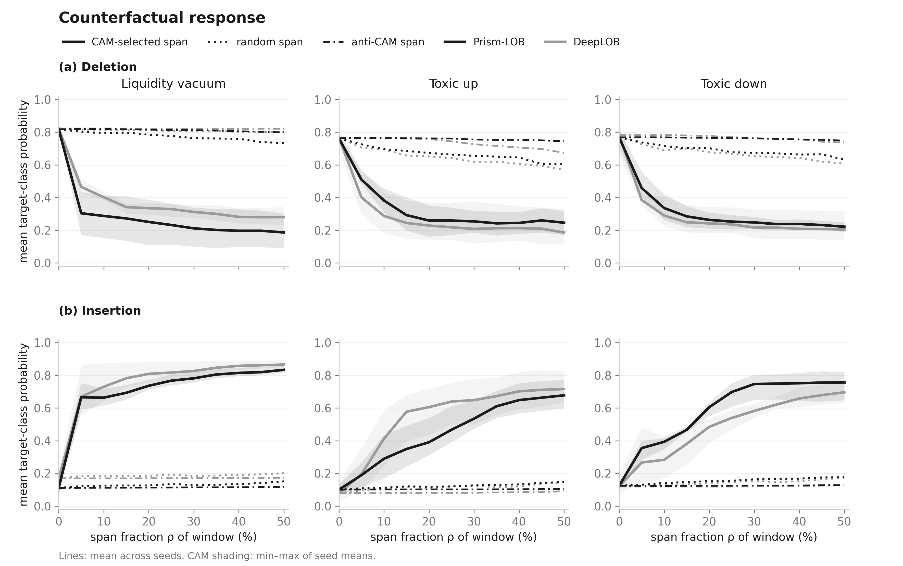

# Prism-LOB

지정가 주문장(LOB)에서 **독성 주문흐름(toxic flow)**과 **유동성 공백(liquidity vacuum)** 위험을 예측하고, 그 예측 근거를 **분기별 귀속**과 **섭동 점검(구간 대체·복원)**으로 살펴보는 연구 코드입니다.

> Jihong Park, Eunho Koo. **Prism-LOB: Structured Evidence and Perturbation Audits for Limit Order Book Risk Prediction.**

Prism은 **P**ositional **R**eadout over **I**nterpretable **S**emantic **M**odules의 약자입니다. 매도 가격·매도 수량·매수 가격·매수 수량을 네 의미 그룹으로 구분해, **“어느 그룹의, 어느 시점이 예측을 이끌었는가?”**를 측정하고 해당 구간에 개입해 볼 수 있게 합니다. 원고는 정식 공개 또는 출판 후 연결할 예정입니다.

**Prism-LOB**은 논문의 모델 이름이며, **`prism_lob_tcn`**은 이 GitHub 저장소의 이름입니다.

[English](README.md) · [실행·재현 안내](docs/REPRODUCE.md) · [논문–코드 대응표](docs/PAPER_MAP.md) · [문서 목록](docs/README.md)

## FI-2010 데이터는 어디에서 왔나요?

이 연구는 Ntakaris et al.의 **FI-2010** 벤치마크를 사용합니다. 원 데이터는 NASDAQ Nordic의 5개 종목에 대해 연속된 10거래일의 주문장을 정규화한 자료입니다.

| 출처 | 링크 |
|---|---|
| 데이터셋을 소개한 논문 | Ntakaris et al., *Benchmark Dataset for Mid-Price Forecasting of Limit Order Book Data with Machine Learning Methods*, Journal of Forecasting. [DOI](https://doi.org/10.1002/for.2543) · [논문 전문](https://arxiv.org/abs/1705.03233) |
| 데이터 배포 기록 | [Fairdata / Etsin의 FI-2010 페이지](https://etsin.fairdata.fi/dataset/73eb48d7-4dbc-4a10-a52a-da745b47a649) |

데이터는 저장소에 포함하지 않습니다. 학습·평가에는 다음 CSV를 사용합니다.

```text
data/FI2010/FI2010_train.csv   # 학습·검증용: 362,400행
data/FI2010/FI2010_test.csv    # 테스트용: 31,937행
```

각 행에서 상위 10개 호가 수준의 가격·수량 40개 변수를 읽고, FI-2010의 z-score 정규화 값을 사용합니다. FI-2010의 원래 가격 방향 라벨 대신 이 연구의 위험 라벨을 코드에서 계산합니다.

**원 데이터의 공개 출처와 현재 실험 CSV의 생성 이력은 구분해야 합니다.** 원 배포본에서 어떤 파일·기간·행을 선택해 위 CSV를 만들었는지는 아직 완전히 기록되어 있지 않습니다. 파일 형식, 시간순 분할, SHA-256과 재현에 필요한 확인 사항은 [데이터 안내](docs/DATA.md)에 정리했습니다.

## 무엇을 예측하고, 어떻게 설명을 점검하나요?

최근 100개 주문장 스냅샷으로 입력 윈도를 만들고, 윈도 끝과 미래 시점의 최우선 호가를 비교합니다.

| 예측 과제 | 예측 시차 | 무엇을 예측하는가 |
|---|---|---|
| 독성 주문흐름 | 10스텝 | 최우선 매도가의 상승 또는 최우선 매수가의 하락에 따른 `stationary / toxic up / toxic down` |
| 유동성 공백 | 30스텝 | 최우선 수량 감소와 스프레드 대리 지표 증가가 함께 나타나는 `normal / vacuum` |

두 라벨은 시장 위험의 **대리 지표**입니다. 정확한 임계값과 조건은 [라벨 구현](lob_xai/microstructure_labels.py)과 [실험 상수](lob_xai/paper_protocol.py)에 있습니다.

예측 이후에는 귀속이 가리킨 특징과 시간 구간을 실제로 바꿔 보면서 모델의 반응을 확인합니다.

| 설명 점검 | 무엇을 보는가 | 코드와 실험 기록 |
|---|---|---|
| 분기 귀속과 특징 대체 | 중요하다고 표시된 가격·수량 그룹을 학습 평균으로 바꿨을 때, 목표 클래스의 로짓도 그 순위에 맞게 변하는가? | [분기 분석](scripts/analyze_branch_importance.py) · [표 분석 안내](docs/PAPER_MAP.md) |
| 시간 가중치와 귀속의 관계 | 학습된 시간 가중치가 Grad-CAM과 HiResCAM의 관계에 어떻게 반영되는가? | [귀속 구현](lob_xai/gradcam.py) · [원고·그림 대응](docs/PAPER_MAP.md) |
| 시간 구간 대체·복원 | CAM이 고른 구간을 대체하면 예측이 더 잘 바뀌고, 복원하면 목표 예측이 더 잘 돌아오는가? 무작위·anti-CAM 구간과 비교하면 어떠한가? | [개입 구현](lob_xai/counterfactual_test.py) · [결과 경로 안내](figures/README.md) |

구간 대체는 남겨 둔 문맥을 기준으로 학습 데이터에서 이웃 표본을 고릅니다. 구간 복원은 학습 데이터에서 문맥 조건 없이 뽑은 기준 표본에 원래 구간을 되돌려 넣습니다. 분기 대체의 로짓 변화는 부호를 유지하므로 항상 감소하는 것은 아닙니다. 이 점검은 정해진 표본군과 개입 방식에 대한 **모델의 반응**을 보여 줍니다.

### 저장된 결과에서 볼 수 있는 예

고신뢰의 올바른 toxic-up 경보에서 구간의 50%를 대체했을 때, 원고가 보고하는 클래스 전환율은 CAM 선택 약 **82%**, 무작위 선택 약 **25%**입니다(3개 seed 평균). 해당 수치에 대응하는 분석 코드와 표본 조건은 [논문–코드 대응표](docs/PAPER_MAP.md)의 표 2에 연결되어 있습니다.



*위 그림의 삭제 곡선은 신뢰도 층화로 고른 올바른 경보, 삽입 곡선은 고신뢰의 올바른 경보를 사용합니다. 두 방향의 표본군은 다르며, 위 82%/25% 요약과 그림의 삭제 곡선을 같은 표본의 결과로 읽으면 안 됩니다.*

탐지 성능과 설명 점검의 구현·입력 범위는 [논문–코드 대응표](docs/PAPER_MAP.md)에서 확인할 수 있습니다. 탐지 표의 일부 출처·수치와 데이터 변환 이력 등 미해결 사항은 [확인 중인 사항](docs/KNOWN_ISSUES.md)에 남겨 두었습니다.

## 빠른 시작

Python 3.10 이상이 필요합니다. 아래 명령은 저장소 루트에서 실행합니다.

```sh
python -m venv .venv
```

PowerShell에서는 `.\.venv\Scripts\Activate.ps1`, Bash에서는 `source .venv/bin/activate`로 활성화합니다.

```sh
python -m pip install -e .
python -m unittest discover -s tests -v
python scripts/check_docs.py
python scripts/smoke_pooling.py --pool positional
```

**위 점검에는 FI-2010 데이터가 필요하지 않습니다.** 완성된 그림은 [논문 PNG 목록](figures/README.md)에서 바로 볼 수 있습니다. 기존 CF 원자료는 포함하지 않으므로 현재 checkout만으로 CF 곡선을 다시 집계할 수는 없습니다.

데이터를 준비한 뒤에는 논문 설정 파일로 학습할 수 있습니다.

```sh
python scripts/train_microstructure.py "@configs/paper/toxic.args" --seed 1 --name paper_toxic_seed1
python scripts/train_microstructure.py "@configs/paper/vacuum.args" --seed 1 --name paper_vacuum_seed1
```

Seed 2·3도 이름과 함께 바꾸어 실행합니다. 이 설정은 positional readout을 선택하고 학습·검증까지만 수행합니다. 기본 CLI의 과거 GAP 설정과 혼동하지 않도록 설정 파일을 사용하세요. 테스트 평가, checkpoint 확인, 새 귀속·개입 실험은 [실행·재현 안내](docs/REPRODUCE.md)를 따릅니다.

## 저장소 구성과 코드 읽는 순서

| 경로 | 역할 |
|---|---|
| [`lob_xai/`](lob_xai/) | 데이터, 위험 라벨, 모델, 학습·평가, 귀속·개입 점검의 핵심 구현 |
| [`models/`](models/) | DeepLOB, TLOB, BiN-CTABL 비교 모델 |
| [`configs/paper/`](configs/paper/), [`scripts/`](scripts/) | 논문 학습 설정과 학습·평가·분석 실행 스크립트 |
| [`lob_xai_viz/`](lob_xai_viz/) | 지정된 입력과 checkpoint를 사용하는 논문 그림 생성기 |
| [`tests/`](tests/) | 라벨·모델·실험 절차의 동작 점검 |
| [`docs/`](docs/) | 데이터·실행 안내와 표·그림 분석 코드의 연결 |

코드는 다음 순서로 읽으면 실험의 흐름을 따라가기 쉽습니다.

1. [실험 상수](lob_xai/paper_protocol.py) → [위험 라벨](lob_xai/microstructure_labels.py)과 [입력 데이터](lob_xai/data.py)
2. [모델](lob_xai/models.py) → [학습](lob_xai/training.py)과 [평가 지표](lob_xai/metrics.py)
3. [귀속](lob_xai/gradcam.py) → [구간 대체·복원](lob_xai/counterfactual_test.py)

실행 흐름은 **데이터 → 학습 → checkpoint → 평가·개입 → 그림**입니다. [단계별 실행 코드](scripts/README.md)에서 각 단계를 연결해 볼 수 있습니다. `configs/paper/*.args`는 학습 명령이 읽는 설정이고, `docs/REPRODUCE.md`는 실행 순서입니다. 모델·데이터 적재는 `lob_xai/checkpoints.py`, 분기 분석 공통 기능은 `lob_xai/branch_analysis.py`에서 공유합니다.

## 실험 기록은 어디에 있나요?

| 확인할 자료 | 저장 경로 |
|---|---|
| 논문 그림 PNG | [figures/README.md](figures/README.md): 경보 카드, CF 곡선, 귀속 분해, 대표 경보 갤러리 |
| 모델 식별 정보 | [configs/paper/checkpoints.json](configs/paper/checkpoints.json): 기존 모델의 해시 기록이며 가중치 파일은 미포함 |
| 표·그림 분석 코드와 새 실행의 입력 | [논문–코드 대응표](docs/PAPER_MAP.md), [실행·재현 안내](docs/REPRODUCE.md) |

미공개 원고와 기존 학습 run·로그·가중치 파일은 포함하지 않습니다. 평가하려면 직접 학습하거나 호환 checkpoint를 별도로 준비하세요. `figures/`에는 PNG와 그림 목록만 제공합니다. 기존 탐지 집계·분기 분석·CF 원자료와 과거 그림은 포함하지 않습니다. 표의 수치를 다시 계산하려면 필요한 데이터와 checkpoint로 분석을 새로 실행하거나 해당 원자료를 별도로 준비해야 합니다.

## 인용과 이용

저자·제목·저장소 정보는 [CITATION.cff](CITATION.cff)에 있습니다. 출판 DOI와 오픈소스 라이선스는 아직 선언되어 있지 않습니다. FI-2010의 이용 조건은 원 배포처를 따릅니다.
