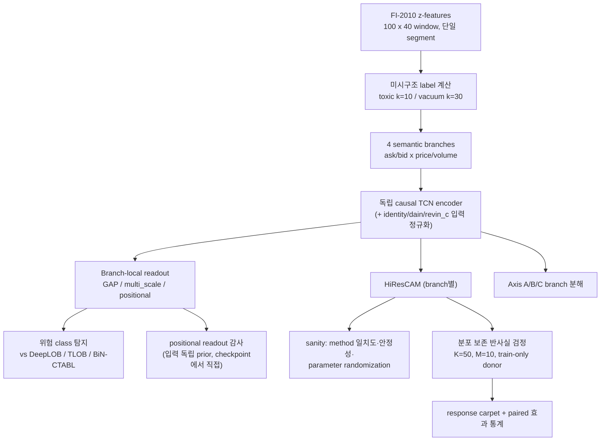

> **역사 기록:** 아래 내용은 당시 버전의 작업·실험 상태다. 현재 실행법은 [REPRODUCE.md](REPRODUCE.md), 현재 결과 출처는 [PAPER_MAP.md](PAPER_MAP.md), 남은 문제는 [KNOWN_ISSUES.md](KNOWN_ISSUES.md)를 따른다. 경로와 명령을 현재 실행 지시로 사용하지 않는다.

# LOB-XAI 통합 저장소

FI-2010 limit order book에서 미시구조 위험(toxic flow, liquidity vacuum)을 탐지하는 4-branch TCN과, 그 예측 근거를 검증하는 XAI 파이프라인(HiResCAM, 분포 보존 반사실 검정, branch 분해)의 단일 저장소다. 기존 감사 정리본(`lob_xai_paper_code`)에 branch-local pooling 실험(`multi_scale`, `positional`)과 그 시각화·검증 도구를 정식 편입했다. 결과에 영향을 주는 수치는 [`lob_xai/paper_protocol.py`](../lob_xai/paper_protocol.py)가 단일 기준이다.

원고 제출 차단 사항과 코드 수정 이력은 [`docs/PAPER_CODE_AUDIT.md`](PAPER_CODE_AUDIT.md), 현재 실험 진행 상태는 [`docs/EXPERIMENT_STATUS.md`](EXPERIMENT_STATUS.md)에 있다.

## 연구 흐름



## 저장소 구조

| 경로 | 내용 |
|---|---|
| `lob_xai/` | 핵심 라이브러리: 데이터/label/모델/학습/CAM/반사실/프로토콜 |
| `models/` | 비교 baseline (DeepLOB, TLOB, BiN-C(TABL)) |
| `scripts/` | 학습·감사·평가·실험 runner |
| `scripts/common/` | Axis A/B/C, response carpet, positional readout, saliency shape |
| `paper/` | 논문 그림·표 생성 (verified 산출물만 입력으로 받음) |
| `lob_xai_viz/` | 단일 공식 loader (`viz_micro_loader.py`) |
| `frozen/` | 동결 run manifest와 branch 설정 (SHA-256 포함) |
| `tests/` | 프로토콜·label·pooling 계약 테스트 |
| `audit/` | 정적 감사 판정 |
| `docs/` | 실험 설계·감사·상태 문서 |

## 설치와 빠른 검증

```bash
python -m venv .venv && source .venv/bin/activate
pip install -e .

# 1) 단위 테스트 (pooling 계약 테스트 포함)
PYTHONDONTWRITEBYTECODE=1 PYTHONPATH=. python -m unittest discover -s tests -v

# 2) baseline 구조 검증
PYTHONPATH=. python scripts/verify_baseline_models.py --device cpu

# 3) pooling smoke (forward/backward/strict-reload/parameter count)
PYTHONPATH=. python scripts/smoke_pooling.py --pool positional
PYTHONPATH=. python scripts/smoke_pooling.py --pool multi_scale

# 4) 동결 checkpoint가 현재 코드로 strict 로드되는지 확인 (PyTorch>=2.6 대응)
PYTHONPATH=. python scripts/verify_positional_checkpoint.py \
  --manifest frozen/positional_6ckpt_manifest.json
```

코드를 리팩토링한 뒤에는 반드시 4)를 다시 실행해 frozen checkpoint 호환을 확인한다.

## 논문 기준 프로토콜

| 구분 | 기준값 |
|---|---|
| 입력 | `T=100`, `F=40`, 4-branch(type4: ask_price/ask_volume/bid_price/bid_volume) |
| 분할 | development file 내 시간순 train/val = 82.35/17.65 + 별도 test file, 단일 segment (실현 전체 비율 75.7/16.2/8.1 — 제공 CSV상 합산 70/15/15는 재구성 불가, 원고도 이 선언으로 수정) |
| 운영 지평 | toxic `k=10`, vacuum `k=30` (탐지 비교표는 두 과제 모두 `k=10`) |
| 학습 | weighted CE, AdamW, cosine, batch 256, 최대 100 epochs, patience 10 |
| 선택 | validation macro-F1 checkpoint, seed 1/2/3 |
| 반사실 (deletion) | train-partition pool 30,000, `K=50`, `M=10`, 삭제율 5–50% (비중첩 retention) |
| 반사실 (insertion) | 동일 pool·grid·seed. rho=0 기준선 = training pool의 **무조건부 전체-창 추출**(보존 context가 없어 조건화 미정의), rho>0 = 선택 구간만 원본 복원. deletion과 같은 비중첩 곡선이므로 단조 회복 경로로 해석 금지 |
| CAM | post-residual/pre-pool branch output의 HiResCAM |
| branch drop-one | training partition 평균 branch feature map (C,T)로 대체 — 선형 readout(GAP/multi_scale/positional)과 합성 가능 |

### Pooling readout (branch-local, 입력 독립)

| pool | branch당 추가 파라미터 | 성질 |
|---|---|---|
| `avg` (GAP) | 0 | 모든 시점 1/T 균등 |
| `multi_scale` | 3 (`--pool-windows 8 32 100`) | tail 평균들의 convex 혼합 |
| `positional` | 100 | 시점별 softmax 가중, 0-초기화 시 정확히 GAP |

두 readout 모두 branch activation에 선형이고 sample-dependent attention이 아니다. HiResCAM은 그대로 계산 가능하지만, **"GAP라서 Grad-CAM == HiResCAM"이라는 특수 논증은 채택 시 원고에서 제거해야 한다.** 학습된 위치 가중치는 입력 독립적 readout prior이며 attention map이나 창 단위 saliency로 서술하면 안 된다.

파라미터 수(입력 정규화 제외, 분석값): GAP 141,955(3-class)/141,890(2-class), multi_scale 141,967/141,902, positional 142,355/142,290. `revin_c` 입력 정규화는 +84. 실제 수는 각 run에 저장되고 테스트가 분석값과 일치를 강제한다.

## 학습

```bash
export PYTHONPATH=.

# 제안 모델 (GAP 기준)
python scripts/train_microstructure.py \
  --task toxic --k 10 --seed 1 \
  --train-csv data/FI2010/FI2010_train.csv \
  --test-csv  data/FI2010/FI2010_test.csv \
  --name ours_toxic_seed1_k10

# branch-local pooling
python scripts/train_microstructure.py \
  --task vacuum --k 30 --seed 1 --pool positional --input-norm identity \
  --train-csv ... --test-csv ... --dev-only --name poolab_positional_...

# baseline (동일 label/split/loader)
python scripts/train_baseline_microstructure.py --model deeplob --task toxic --k 10 --seed 1 ...
```

### Pooling ablation (GAP 대조군과 seed-일치 비교, test 봉인)

```bash
EXPERIMENT_POOL=positional MODE=screen DEVICE=cuda \
TRAIN_CSV=... TEST_CSV=... bash scripts/run_pooling_experiment.sh   # seed 1
EXPERIMENT_POOL=positional MODE=full   DEVICE=cuda ... # seed 1,2,3 + GAP 대조군
```

모든 ablation 학습은 `--dev-only`로 test 추론을 봉인한다. 사전 판정 기준은 [`docs/POOLING_EXPERIMENT.md`](POOLING_EXPERIMENT.md) 참고.

### 최종 test 개봉 (1회)

설정을 동결한 뒤에만 실행한다. 자세한 절차와 주의는 [`docs/BRANCH_PERFORMANCE_EXPERIMENT.md`](BRANCH_PERFORMANCE_EXPERIMENT.md)의 Stage 3.

```bash
bash scripts/run_locked_current_final_test.sh   # devsel_* GAP 계열용
python scripts/evaluate_ours_checkpoint.py --checkpoint ... --confirm-final-test
```

## 동결 자산 (`frozen/`)

| 파일 | 내용 |
|---|---|
| `positional_6ckpt_manifest.json` | positional 3-seed × 2-task 6개 checkpoint (경로·SHA-256·데이터 identity) |
| `task_specific_selected_6ckpt_manifest.json` | validation 선택 결과: **toxic=multi_scale, vacuum=positional** |
| `branch_config_toxic_multiscale.json`, `branch_config_vacuum_positional.json` | probe로 검증된 branch/fusion 지점 설정 |

toxic multi_scale checkpoint는 sibling 저장소(`lob_xai_multiscale_pooling`)의 run을 가리킨다. manifest의 절대 경로는 실행 환경 기준이므로 환경이 바뀌면 SHA-256으로 대조한다.

## XAI 분석 도구

| 도구 | 명령 | 산출물 |
|---|---|---|
| 반사실 충실성 검정 (deletion=필요성) | `python -m lob_xai.counterfactual_test --model ours --ckpt ... --task toxic --k 10 --seed 1` | 집계·창 단위 retention CSV |
| 반사실 insertion (충분성) | 위 명령 + `--direction insertion` (또는 `both`) | `*_insertion.png/.csv/.windows.csv` — 무조건부 train-donor 전체 창 기준선에서 CAM 상위 구간 복원 시 회복 곡선·recovery rate |
| Response carpet | `MODE=full DEVICE=cuda bash scripts/run_response_carpet.sh` | 창×삭제율 retention carpet (CAM/random/anti) |
| Branch 구조 probe | `python scripts/common/probe_branch_structure.py --ckpt ... --config-out branch_config.json` | 검증된 branch 설정 |
| Axis A (점유율 vs 개입) | `python scripts/common/axis_a_min.py --ckpt ... --config branch_config.json` | drop-one 효과와 CAM 점유율 비교 |
| Axis B (동역학 구조) | `python scripts/common/axis_b_branch_structure.py ...` | SUPPORTED/EXPLORATORY 판정 |
| Axis C (반합성 주입) | `python scripts/common/axis_c_synthetic_localization.py ...` | 부록용 능력 점검 |
| Positional readout 그림 | `bash scripts/run_positional_visualization.sh` | branch별 시간 가중 profile + enrichment/lag |
| Pool 가중치 덤프 | `python scripts/inspect_pool_weights.py ...` | JSON 가중치·통계 |
| Saliency shape | `python scripts/common/make_saliency_shape.py --task vacuum ...` | 분산도/last25-mass 그림·표 |
| CAM sanity 검사 | `python scripts/common/cam_sanity_checks.py --ckpt ... --task vacuum --target 1 --out-json ...` | method 일치도, 입력 섭동 안정성, parameter randomization |
| CF paired 효과 통계 | `python scripts/common/cf_effect_stats.py --npz figures/cf_response_carpet/full/*/*.npz --out-csv ... --out-json ...` | 창 단위 paired AUC, bootstrap CI, one-sided Wilcoxon |
| Checkpoint 검증 | `python scripts/verify_positional_checkpoint.py --manifest frozen/...json` | strict 로드·SHA·파라미터 검증 |

carpet의 cohort는 기본 `stratified_correct`(정답 경보 신뢰도 전 구간)로, 집계 반사실 표의 top-400 cohort와 다르다. 그림과 표를 같이 쓸 때는 이 차이를 캡션에 명시한다. carpet의 행은 모델 간 짝지어지지 않는다.

## Provenance 규칙

최종 표·그림마다 데이터·checkpoint SHA-256, label 지평, 실제 split 비율, seed와 학습 config, 코드 tree SHA-256과 생성 명령, cohort 정의를 `scripts/make_run_manifest.py`로 보관한다. 논문 수치는 검증된 CSV/JSON 산출물에서 생성하고 손으로 옮기지 않는다. `--allow-split-mismatch`, `--pred-based`, `--allow-unverified-data`, `ALLOW_UNVERIFIED=1`은 진단 전용이며 논문 결과에 쓰지 않는다.

## 문서

| 문서 | 내용 |
|---|---|
| [`docs/EXPERIMENT_STATUS.md`](EXPERIMENT_STATUS.md) | 실험 이력 재구성과 현재 상태, 남은 결정 |
| [`docs/POOLING_EXPERIMENT.md`](POOLING_EXPERIMENT.md) | branch-local pooling 실험 설계·판정 기준 |
| [`docs/BRANCH_PERFORMANCE_EXPERIMENT.md`](BRANCH_PERFORMANCE_EXPERIMENT.md) | depth sweep 진단과 Stage 0–3 절차 |
| [`docs/PAPER_CODE_AUDIT.md`](PAPER_CODE_AUDIT.md) | 제출 차단 항목과 결과 변경형 코드 수정 내역 |
| [`docs/LEGACY_EXCLUSIONS.md`](LEGACY_EXCLUSIONS.md) | 의도적으로 제외한 레거시 경로 |
| [`docs/CLEANUP_COMPARISON.md`](CLEANUP_COMPARISON.md) | 외부 정리 제안본과의 비교, 채택/기각 근거 |

CI: push/PR마다 `.github/workflows/ci.yml`이 CPU에서 단위 테스트·pooling smoke·baseline 검증을 실행한다.

CAM sanity와 CF paired 통계의 겹침 주의: 평가 창들이 시간적으로 겹치므로 창 단위 p-value는 기술 통계로 취급한다. `split_within_segments(..., purge_gap=N)`은 train/validation 경계 의존성을 줄이는 opt-in 장치이며(기본 0 = 동결 동작), 사용 시 run config와 원고에 명시해야 한다.
